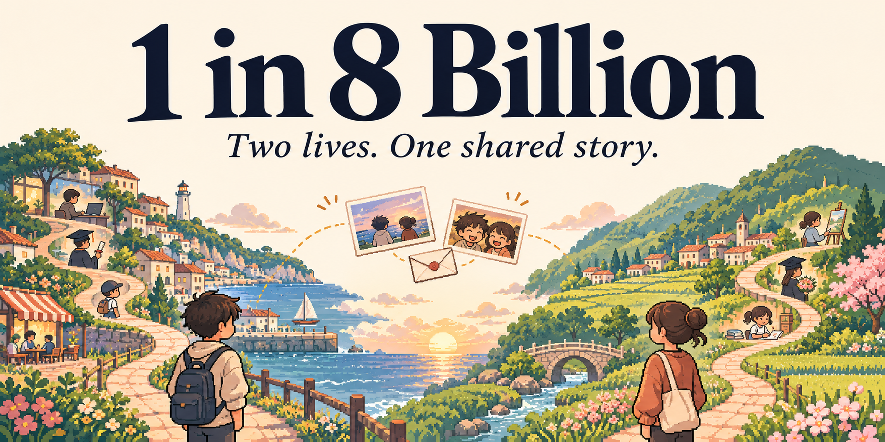
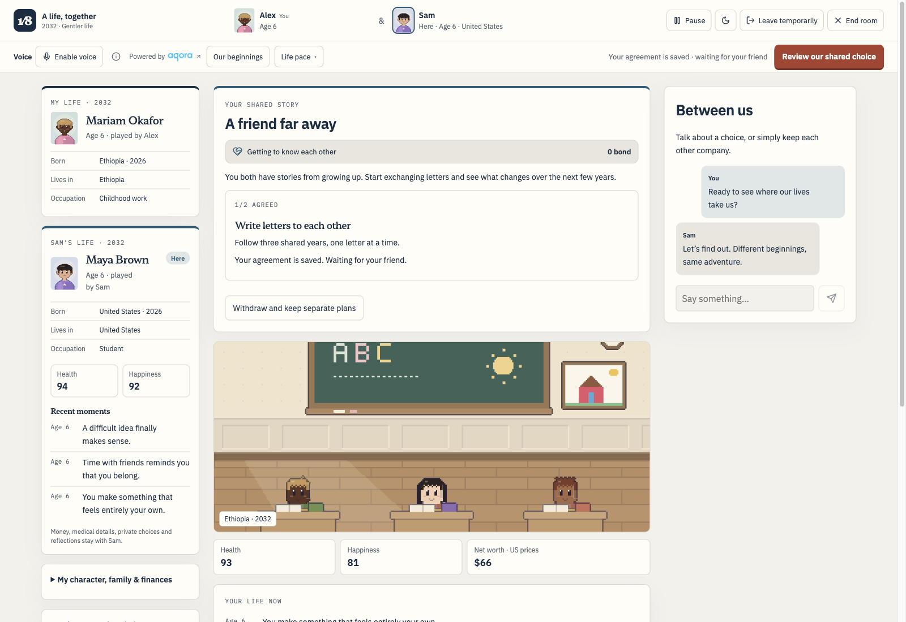
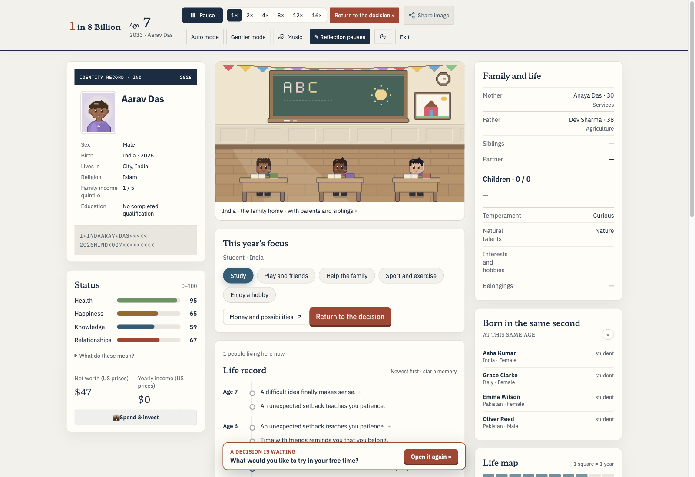
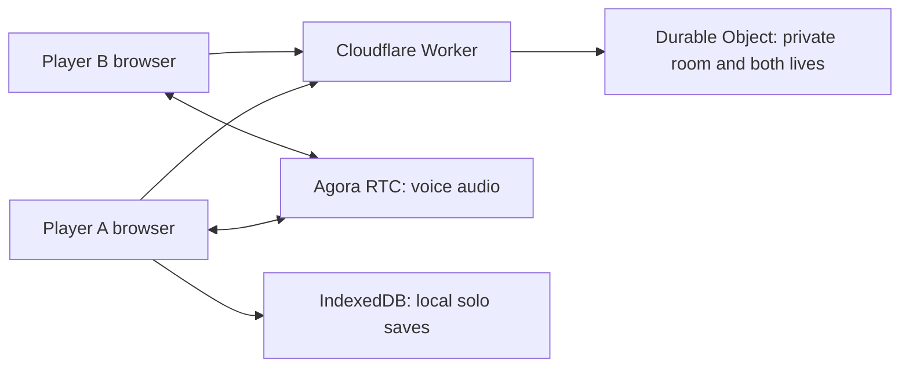

<p align="center">
  
</p>

<h1 align="center">1 in 8 Billion</h1>

<p align="center">
  <strong>Be born somewhere. Live a whole life. Bring a friend.</strong><br />
  A free browser life simulator with 172 countries and territories, personal choices,<br />
  and a two-player mode with optional Agora voice chat.
</p>

<p align="center">
  <a href="https://1in8bn.com/"><strong>Play solo</strong></a> ·
  <a href="https://1in8bn.com/together/"><strong>Play together</strong></a> ·
  <a href="#run-locally">Run locally</a> ·
  <a href="#voice-powered-by-agora">Agora integration</a> ·
  <a href="README_CN.md">简体中文</a>
</p>

<p align="center">
  <a href="https://www.agora.io/en/"></a>
</p>

## A life you did not choose. A story you make your own.

Where you are born changes what comes next. Start in a randomly drawn country and household, then navigate school, work, relationships, health, and the unexpected—one year at a time.

Play on your own, or invite one friend into **A life, together**. You each have a different character and your own decisions. Watch both lives unfold, talk about the surprises, and agree on the moments you share.

- **Two independent lives, one room.** Grow from birth to farewell, with shared goals from childhood onward. Decisions that affect both players need both players' agreement.
- **Talk while you play.** Optional Agora voice chat, mute and leave controls, and room text chat. No player account or app download required.
- **A world of different beginnings.** Draw from 172 countries and territories, explore different eras, and choose birth-weighted or population-weighted starts in solo setup.
- **Keep the story.** Local saves, family histories, keepsakes, and images you can download or share.

All game and keepsake features are free. Outcomes are fictional simulations informed by statistical snapshots, not predictions about an individual life.

## A life, together

1. **Create a room.** Pick a nickname and choose the level of life's uncertainty.
2. **Invite one friend.** Send the private invitation link. Both players choose their pace and get ready.
3. **Live your own life.** Make personal choices, follow your friend's public story, and take on shared goals.
4. **Save your memories.** Keep your own recap and decide together whether to play again.

<p align="center">
  
</p>

Your friend sees your character's public story and wellbeing, while money, private decisions, and written reflections stay out of their view. You can leave temporarily and return to your seat using the same browser. Room credentials belong to the browser that joined; an invitation is not an account or a cross-device login.

## A life of your own

Explore education, careers, family generations, changing circumstances, and the choices that shape a lifetime. Solo progress is stored locally in IndexedDB, with backup and archive tools in the app.

<p align="center">
  
</p>

The game includes 14 language options: English, Korean, Japanese, Traditional Chinese, Simplified Chinese, Vietnamese, French, Thai, Spanish, German, Turkish, Russian, Portuguese, and Indonesian.

## Run locally

**Requirements:** Node.js 22.13 or newer, and pnpm 11.0.9 as pinned in `package.json`.

```sh
git clone https://github.com/0xRe/1in8b.git
cd 1in8b
pnpm install --frozen-lockfile
pnpm dev
```

Open [solo mode](http://127.0.0.1:3089/) or [two-player mode](http://127.0.0.1:3089/together/).

To customize the site address, edit `SITE` in [`site-identity.ts`](src/lib/site-identity.ts).

Solo play and two-player text rooms do not require Agora credentials. For a local two-player check, open the invitation in another browser or a private window so each player has separate browser storage.

### Enable voice (optional)

Create an Agora project in the [Agora Console](https://console.agora.io/), then copy the example file:

```sh
cp .dev.vars.example .dev.vars
```

Fill in your own values in `.dev.vars`, then restart the dev server:

```dotenv
AGORA_APP_ID="your_agora_app_id"
AGORA_APP_CERTIFICATE="your_agora_app_certificate"
```

The App Certificate stays on the server. `.dev.vars` is Git-ignored; do not put the certificate in browser code. Both players must join the room, enable voice, and allow microphone access. Microphones require HTTPS or a trustworthy local origin such as `http://127.0.0.1`.

## Voice powered by Agora

The game handles story state; Agora handles the audio conversation. Voice starts only when a player enables it, and this application does not record or transcribe calls.

1. The browser requests a voice ticket using its room credential.
2. The Worker checks active room membership and that both friends are present.
3. The server signs a short-lived token scoped to the room channel and player UID.
4. The client loads the Agora SDK on demand, publishes the microphone, and subscribes to the authorized peer.
5. The client renews tokens and releases the microphone when voice ends.

Tokens last 15 minutes and are renewed during an ongoing session. This is a credential lifetime, not a fixed 15-minute call limit. Audio quality and connectivity depend on the devices, browser permissions, and network.

| Start here | Responsibility |
| --- | --- |
| [`DuoVoice.tsx`](src/components/DuoVoice.tsx) | Voice controls, permissions, setup deadlines, and error messages |
| [`duo-voice.ts`](src/lib/duo-voice.ts) | Join, publish, subscribe, mute, renew, and cleanup |
| [`duo-voice-api.ts`](src/lib/duo-voice-api.ts) | Server-side membership checks and RTC token generation |
| [`duo-room.ts`](src/duo-room.ts) | Room membership, presence, and persisted story state |

## How it fits together



| Layer | Stack |
| --- | --- |
| UI and server rendering | React 19, TanStack Start |
| Life simulation | TypeScript rules, seeded progression, country datasets |
| Room coordination | SQLite-backed Cloudflare Durable Objects; authenticated polling and commands |
| Voice | `agora-rtc-sdk-ng` and server-side `agora-token` |
| Tooling | Vite, TypeScript, pnpm, Node.js test runner |

## License

[MIT](LICENSE).
