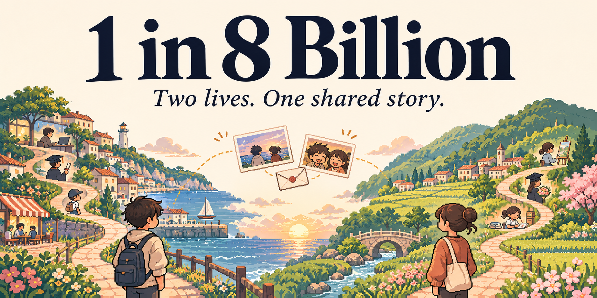
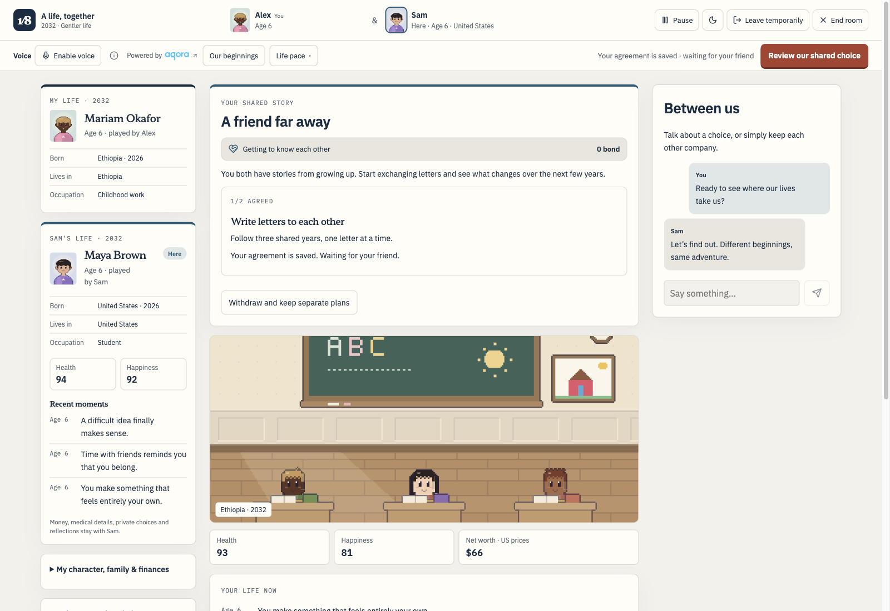
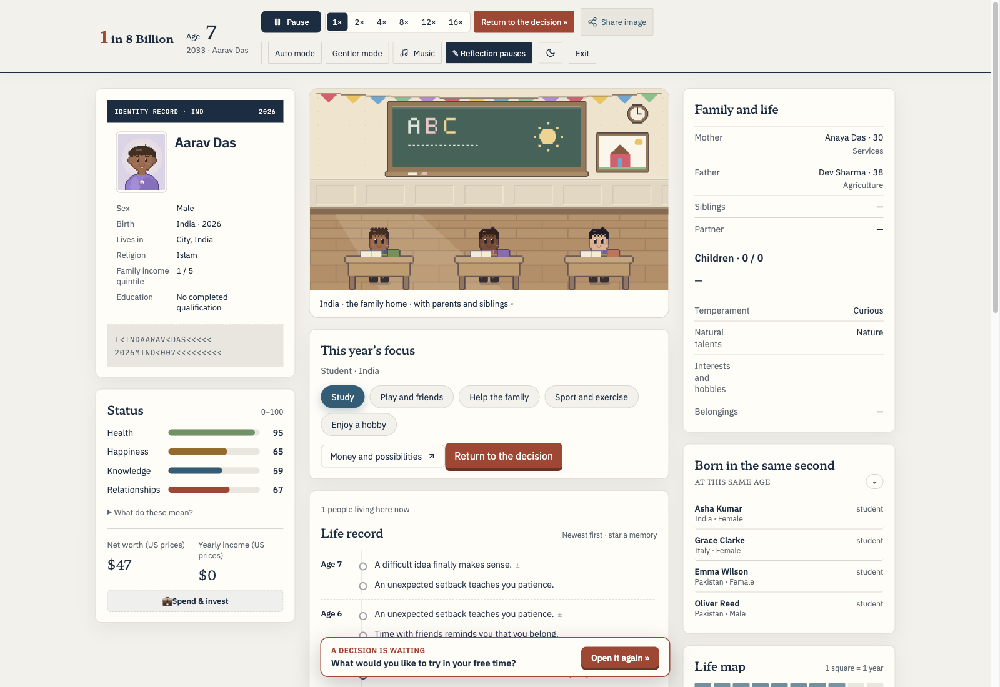
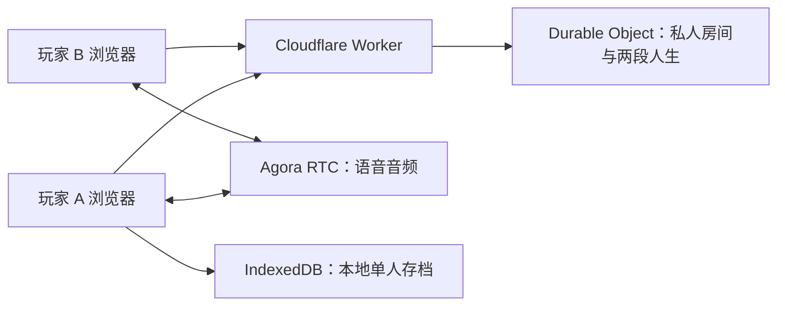

<p align="center">
  
</p>

<h1 align="center">1 in 8 Billion<br />八十亿分之一</h1>

<p align="center">
  <strong>随机降生，走过一生。也可以，叫上一个朋友。</strong><br />
  免费的浏览器人生模拟器：172 个国家与地区、属于自己的选择，<br />
  以及支持 Agora 实时语音的双人同行模式。
</p>

<p align="center">
  <a href="https://1in8bn.com/"><strong>单人游玩</strong></a> ·
  <a href="https://1in8bn.com/together/"><strong>双人同行</strong></a> ·
  <a href="#本地运行">本地运行</a> ·
  <a href="#agora-实时语音">Agora 接入</a> ·
  <a href="README.md">English</a>
</p>

<p align="center">
  <a href="https://www.agora.io/en/"></a>
</p>

## 出生无法选择，故事由你继续

出生在哪里，会改变接下来的人生。随机降生在一个国家和家庭，经历求学、工作、感情、健康与意外，一年一年度过这一生。

你可以独自体验，也可以邀请一个朋友进入 **A life, together（双人同行）**。两个人拥有不同的角色和各自的选择，一边见证彼此的经历，一边聊天，再一起决定那些共同的时刻。

- **两段独立人生，一个共同房间。** 从出生走向告别，从童年开始参与共同目标；影响双方的决定，需要双方同意。
- **边玩边聊。** 支持 Agora 实时语音、静音和退出控制，也支持房间文字聊天。玩家无需注册账号或下载应用。
- **不同的起点。** 覆盖 172 个国家与地区，支持不同时代；单人设置可按出生人数或总人口加权抽取出生地。
- **把故事留下。** 本地单人存档、家族历史、个人纪念卡，以及可以下载或分享的图片。

所有游戏和纪念功能均免费。游戏根据统计快照模拟虚构人生，不是对个人命运的预测。

## 双人同行

1. **创建房间。** 输入昵称，选择人生的不确定程度。
2. **邀请一个朋友。** 发送私密邀请链接，双方选择节奏并准备开始。
3. **经历各自的人生。** 做出个人选择，关注朋友的公开经历，参与共同目标。
4. **保存共同回忆。** 留下自己的故事记录，再一起决定是否重新开始。

<p align="center">
  
</p>

朋友可以看到角色的公开经历及健康、快乐等状态；金钱、私人决策和手写感想不会出现在朋友的视图中。你可以暂时离开，再使用同一浏览器返回自己的席位。房间凭证保存在加入时使用的浏览器中，邀请链接不等于账号或跨设备登录。

## 一个人，也能走过完整一生

探索教育、职业、家族后代、环境变化，以及影响一生的选择。单人进度保存在本地 IndexedDB 中，应用提供备份和档案管理工具。

<p align="center">
  
</p>

游戏提供 14 种语言选项：英语、韩语、日语、繁体中文、简体中文、越南语、法语、泰语、西班牙语、德语、土耳其语、俄语、葡萄牙语和印度尼西亚语。

## 本地运行

**环境要求：** Node.js 22.13 或更新版本，以及 `package.json` 中固定的 pnpm 11.0.9。

```sh
git clone https://github.com/0xRe/1in8b.git
cd 1in8b
pnpm install --frozen-lockfile
pnpm dev
```

打开[单人模式](http://127.0.0.1:3089/)或[双人模式](http://127.0.0.1:3089/together/)。

如需修改站点地址，编辑 [`site-identity.ts`](src/lib/site-identity.ts) 中的 `SITE`。

单人游玩和双人文字房间不需要 Agora 凭证。本地测试双人模式时，请在另一个浏览器或隐私窗口中打开邀请，让双方使用独立的浏览器存储。

### 启用语音（可选）

在 [Agora Console](https://console.agora.io/) 创建项目，然后复制示例文件：

```sh
cp .dev.vars.example .dev.vars
```

在 `.dev.vars` 中填写自己的配置，然后重启开发服务：

```dotenv
AGORA_APP_ID="your_agora_app_id"
AGORA_APP_CERTIFICATE="your_agora_app_certificate"
```

App Certificate 只用于服务端。`.dev.vars` 已被 Git 忽略，不要把证书放进浏览器代码。双方都需要先加入房间，再主动开启语音并允许麦克风访问。麦克风需要 HTTPS，或 `http://127.0.0.1` 这样的可信本地来源。

## Agora 实时语音

游戏负责故事状态，Agora 负责音频通话。玩家主动开启后才会启动语音，本应用不录制或转写通话。

1. 浏览器使用自己的房间凭证请求语音票据。
2. Worker 校验房间成员身份和双方在线状态。
3. 服务端为指定房间频道和玩家 UID 签发短效 Token。
4. 客户端按需加载 Agora SDK，发布麦克风音频，只订阅已授权的另一位玩家。
5. 通话过程中自动续期 Token，退出时释放麦克风。

Token 有效期为 15 分钟，持续会话会自动续期。这是凭证有效期，不是固定的 15 分钟通话上限。音频质量和连通性取决于设备、浏览器权限与网络环境。

| 代码入口 | 职责 |
| --- | --- |
| [`DuoVoice.tsx`](src/components/DuoVoice.tsx) | 语音按钮、权限、连接超时和错误提示 |
| [`duo-voice.ts`](src/lib/duo-voice.ts) | 加入频道、发布、订阅、静音、续期和资源清理 |
| [`duo-voice-api.ts`](src/lib/duo-voice-api.ts) | 服务端成员校验与 RTC Token 生成 |
| [`duo-room.ts`](src/duo-room.ts) | 房间成员、在线状态和故事持久化 |

## 技术架构



| 层级 | 技术 |
| --- | --- |
| 界面与服务端渲染 | React 19、TanStack Start |
| 人生模拟 | TypeScript 规则、固定随机种子的人生演进、国家数据集 |
| 房间协同 | 基于 SQLite 的 Cloudflare Durable Objects；带鉴权的轮询与操作请求 |
| 语音 | `agora-rtc-sdk-ng` 和服务端 `agora-token` |
| 工具链 | Vite、TypeScript、pnpm、Node.js 测试运行器 |

## 许可

[MIT](LICENSE)。
