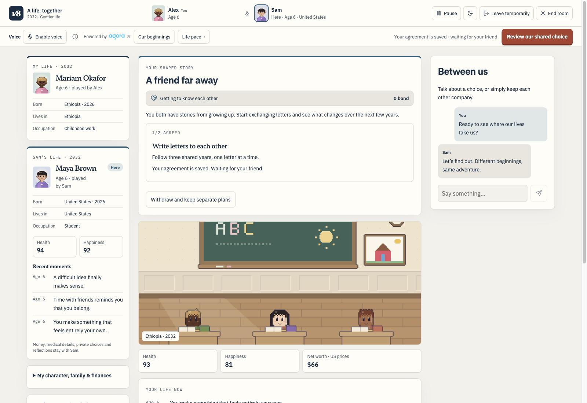
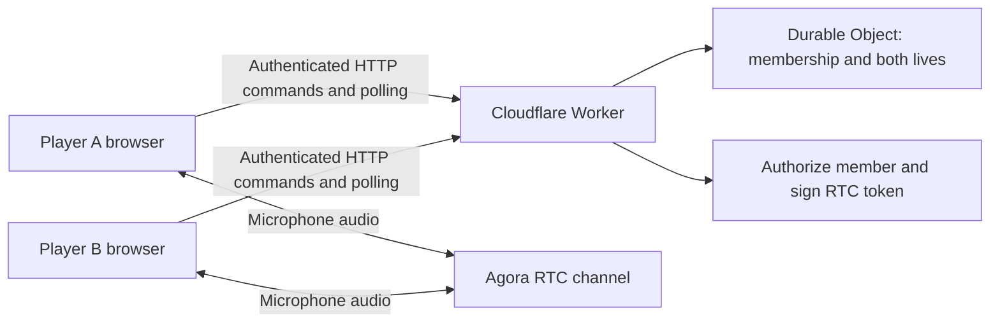

# 1in8b (1 in 8 Billion): Build a two-player life simulator with Agora WebRTC voice chat

How do you add voice chat to a multiplayer browser game without making audio responsible for game state? This guide follows the implementation in [1in8b](https://github.com/0xRe/1in8b), an open-source life simulator with solo and private two-player modes.

Each player lives a different life. They make individual choices, respond to shared events, and can talk about what happens using Agora WebRTC voice chat. You can run the game locally, inspect the implementation, and deploy your own copy on Cloudflare Workers.



## What you will build and learn

- Run a browser life simulator locally, including solo play and private two-player rooms.
- Coordinate two players through an authoritative room on Cloudflare Durable Objects.
- Authorize room members before issuing Agora RTC credentials.
- Publish microphone audio, subscribe to a friend, renew tokens, and release devices on exit.
- Self-host the application with your own Worker and optional Agora credentials.

This is an implementation walkthrough for developers. For the product overview and screenshots, see the [project README](https://github.com/0xRe/1in8b#readme).

## Architecture: room state and voice take separate paths

The application uses React 19 and TanStack Start for the interface and server rendering. TypeScript rules drive the simulation. Solo saves live in IndexedDB; two-player state lives in a SQLite-backed Durable Object.



| Concern | Implementation | Source entry point |
| --- | --- | --- |
| Game rules and progression | TypeScript simulation engines | [duo-engine.ts](https://github.com/0xRe/1in8b/blob/main/src/lib/duo-engine.ts), [duo-lifetime.ts](https://github.com/0xRe/1in8b/blob/main/src/lib/duo-lifetime.ts) |
| Room membership and command ordering | Durable Object | [duo-room.ts](https://github.com/0xRe/1in8b/blob/main/src/duo-room.ts) |
| Room API and authorization | Worker request handlers | [duo-api.ts](https://github.com/0xRe/1in8b/blob/main/src/lib/duo-api.ts) |
| Browser synchronization | Authenticated commands and polling | [DuoGame.tsx](https://github.com/0xRe/1in8b/blob/main/src/components/DuoGame.tsx), [duo-client-lifecycle.ts](https://github.com/0xRe/1in8b/blob/main/src/lib/duo-client-lifecycle.ts) |
| Voice credentials | Server-side Agora token signing | [duo-voice-api.ts](https://github.com/0xRe/1in8b/blob/main/src/lib/duo-voice-api.ts) |
| Voice controls and lifecycle | Agora Web SDK | [DuoVoice.tsx](https://github.com/0xRe/1in8b/blob/main/src/components/DuoVoice.tsx), [duo-voice.ts](https://github.com/0xRe/1in8b/blob/main/src/lib/duo-voice.ts) |

Agora RTC carries the human conversation. Room commands, shared decisions, and text chat use HTTP and Durable Objects. This implementation does not use Agora RTM. An audio failure therefore does not need to end the game or prevent text play.

## 1. Run the open-source life simulator locally

Use Node.js 22.13 or newer and pnpm 11.0.9, as specified in `package.json`.

```sh
git clone https://github.com/0xRe/1in8b.git
cd 1in8b
pnpm install --frozen-lockfile
pnpm dev
```

Open [solo mode](http://127.0.0.1:3089/) or [two-player mode](http://127.0.0.1:3089/together/). The local Vite integration runs the Worker and room storage through Cloudflare's development runtime. You do not need a D1 database or Agora credentials for solo play and room text chat.

Create a room and open its invitation in another browser or private window. Separate browser storage lets you test the two player identities. Join as the second player, complete both readiness steps, and make choices from each side.

## 2. Keep shared decisions on the room server

The Worker validates requests and forwards room operations to the corresponding Durable Object. A room owns membership and the two lives, rather than accepting a browser's replacement copy of the story.

The room serializes request handling with `blockConcurrencyWhile`, including asynchronous checks and writes. Command receipts and version checks protect against retries and stale commands. Presence is stored separately from the larger story so frequent presence updates do not rewrite the complete lifetime record.

For a two-player game, these details matter when both friends click at once or a slow request is retried. Inspect the command path in `duo-room.ts` before changing the client controls. Use `duo-engine.ts` and `duo-lifetime.ts` to understand which choices are independent and which require shared consent.

## 3. Enable Agora WebRTC voice chat

Create your own project in the [Agora Console](https://console.agora.io/) and obtain its App ID and App Certificate. Copy the local configuration template:

```sh
cp .dev.vars.example .dev.vars
```

Fill in `.dev.vars` and restart `pnpm dev`:

```dotenv
AGORA_APP_ID="your_agora_app_id"
AGORA_APP_CERTIFICATE="your_agora_app_certificate"
```

The certificate stays on the Worker. The browser receives an App ID and a short-lived token after authorization; it never receives the certificate. `.dev.vars` is ignored by Git.

Both friends must be present in the room and enable voice. Allow microphone access when prompted. Localhost is suitable for local microphone testing; use HTTPS for a hosted game or a test across physical devices.

## 4. Issue a voice ticket only to an authorized player

The voice endpoint accepts a same-origin POST and checks the caller's room membership, including whether both players are present and the room remains active. A room ID alone does not authorize a call.

The server derives the channel and player UID from the authorized membership. Each room uses its own channel, and its two player seats use distinct numeric UIDs. The token must use the same UID that the client uses to join.

The signing operation in `duo-voice-api.ts` is:

```ts
const ttl = 900;
const token = RtcTokenBuilder.buildTokenWithUid(
  config.appId,
  config.certificate,
  member.channel,
  member.uid,
  RtcRole.PUBLISHER,
  ttl,
  ttl,
);
```

`RtcTokenBuilder` and `RtcRole` come from `agora-token`. The returned ticket includes the channel, local UID, expected peer UID, expiry time, App ID, and token. Both players need publishing permission because both can speak.

The 900-second expiry is the credential lifetime, rather than a 15-minute call limit. The client renews credentials while voice remains active. If Agora credentials are absent, the endpoint returns an unavailable response and the room can continue with text.

## 5. Manage the browser audio lifecycle

`DuoVoice.tsx` loads the Agora SDK on demand in the browser, so server rendering does not evaluate the media SDK. `duo-voice.ts` manages the session independently of the game engine.

Follow the complete implementation when reusing this flow:

1. Request an authorized voice ticket and create an RTC client with `mode: 'rtc'`.
2. Register publication, departure, connection, and token-expiry handlers before joining.
3. Create a microphone track with `speech_standard`, echo cancellation, gain control, and noise suppression enabled.
4. Join with the ticket's App ID, channel, token, and UID, then publish the microphone.
5. Subscribe to audio from the expected peer UID. Reconcile peers already publishing when the join completes.
6. Mute through the microphone track's `setMuted` method. Renew tokens before expiry and handle the SDK's expiry notification.
7. On exit or failure, stop and close the microphone, remove event handlers, clear timers, and leave the channel.

The implementation also guards asynchronous work with a session generation counter. If a user leaves while microphone permission or joining is still pending, an old completion must not reactivate the call.

These lifecycle details are useful beyond this game: a browser voice feature needs to handle cancellation, permission rejection, late callbacks, and a friend leaving as well as the successful join path.

## 6. Self-host on Cloudflare Workers

This application includes a server and Durable Object binding, so deploy it as a Worker rather than as static files alone. Use your own Cloudflare account and Worker name.

Before building:

1. Change `name` in `wrangler.jsonc` to your Worker name.
2. Keep the `DUO_ROOMS` binding and the `duo-v1` migration that creates the SQLite-backed `DuoRoom` class. No separate database migration directory or D1 setup is needed.
3. Set `SITE` in `src/lib/site-identity.ts` to your intended public HTTPS origin. It controls the site's canonical URLs.

Build and check the application:

```sh
pnpm build
pnpm typecheck
pnpm test
```

The build runs first here because Vite generates route declarations used by TypeScript. Authenticate to the intended account, check it, and deploy the generated server configuration:

```sh
pnpm exec wrangler login
pnpm exec wrangler whoami
pnpm exec wrangler deploy --config dist/server/wrangler.json
```

The [Cloudflare Vite plugin uses an output configuration](https://developers.cloudflare.com/workers/vite-plugin/reference/migrating-from-wrangler-dev/) that references the built assets. Do not replace the generated server entry with the original TypeScript entry when deploying the build.

After the Worker exists, configure voice secrets through the interactive prompts:

```sh
pnpm exec wrangler secret put AGORA_APP_ID --config dist/server/wrangler.json
pnpm exec wrangler secret put AGORA_APP_CERTIFICATE --config dist/server/wrangler.json
```

Local `.dev.vars` values are not a production secret setup. Cloudflare's [`secret put` command](https://developers.cloudflare.com/workers/configuration/secrets/) creates and deploys a new Worker version. Enter values at the prompts; keep them out of source files and command-line arguments.

If you only learn your final `workers.dev` origin after the first deployment, update `SITE`, rebuild, and deploy again. Test `/` and `/together/` on the final HTTPS origin.

## 7. Check gameplay and voice separately

| Check | Expected result |
| --- | --- |
| Start without Agora credentials | Solo play and room text chat remain available |
| Play solo, reload, and return | Local progress is restored |
| Use two independent browser contexts | Both players can join, become ready, and send text |
| Submit a shared decision | The server applies the game's consent rules |
| Request voice without valid membership | The endpoint rejects the request |
| Enable voice on two devices over HTTPS | Each friend can hear the other after microphone permission |
| Mute, leave, and rejoin | Mute works and leaving releases the microphone |
| Keep a call active through token renewal | Audio can continue beyond the initial token lifetime |

The automated suite covers simulation, save recovery, room authorization, shared consent, and voice lifecycle behavior using SDK stubs. Local gameplay and build checks have been exercised; stub tests do not establish real microphone transmission or audio quality. A new hosted deployment and real two-device calling still need their own acceptance checks.

## Extend the game

Start with simulation rules for new life events, room commands for shared interactions, and the separate voice controller for audio behavior. Keep room authorization ahead of token signing and make voice optional so friends can continue playing when a microphone or network fails.

Get the [open-source implementation](https://github.com/0xRe/1in8b), run it locally, or use the self-hosting steps above to build your own two-player life simulator with Agora WebRTC voice chat.

[MIT License](https://github.com/0xRe/1in8b/blob/main/LICENSE).
